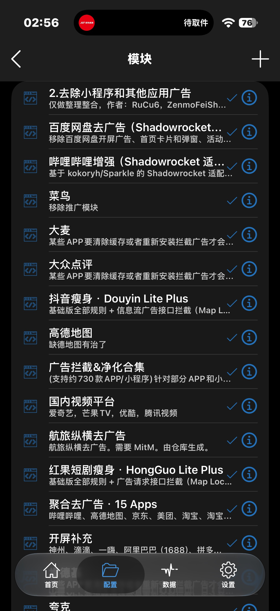
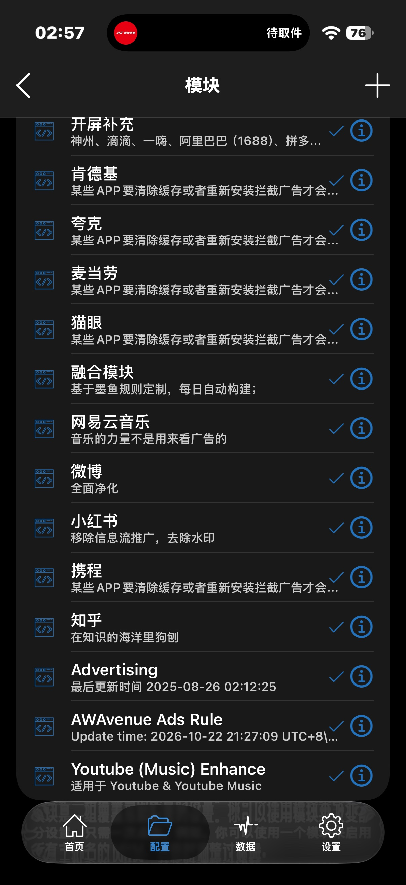

# Shadowrocket 去广告模块合集

这些模块是 AI 帮我找的，我自己一个个装上试过，能用的才放上来，更新时间也都对过。用哪个拿哪个，不用全装。

模块都是别人的，我就是整理了一下。每个模块下面都写了原作者，感谢他们。

## 实测截图

下面是我手机上装好的模块列表，全部启用：

 

## 怎么用

1. 复制想要的模块链接。
2. Shadowrocket → 配置 → 模块 → 右上角 `+`，粘贴进去。
3. 点模块页上方的「更新模块」，重启 Shadowrocket。
4. 带 MITM 的模块要先装证书：配置 → 当前配置右边的 `ⓘ` → HTTPS 解密 → 生成证书，装上，再去 iOS 设置里信任它。

以后更新点一下「更新模块」就行。

## 使用规则

1. 免费的，自己用就行，别拿去卖钱。
2. 用哪个拿哪个，不用全装。
3. 模块是别人的，版权是人家的；转载、引用记得写清楚来源和原作者。
4. 东西都是第三方的，出了问题自己担着。带 MITM 的要信任证书，银行、支付类的 App 别装模块；哪个 App 打不开或者变慢了，先把对应的模块关了试试。
5. 哪个模块失效了、链接打不开了，提个 Issue 告诉我，我看到就更新。
6. 没有一个模块能去掉所有 App 的广告，开屏没模块的只能靠自动点跳过。
7. Advertising 显示的日期是文件里写死的，点更新照常。
8. 费电是因为 Shadowrocket 的 VPN 一直开着，所有流量都要经过它转发、加解密，模块本身不怎么耗电。大概每天多 5–10%。

## 通用规则

| 模块 | 来源 | 最近更新 | 链接 |
|---|---|---|---|
| AWAvenue Ads Rule（秋风） | [TG-Twilight/AWAvenue-Ads-Rule](https://github.com/TG-Twilight/AWAvenue-Ads-Rule) | 2026-10-22 | https://gcore.jsdelivr.net/gh/TG-Twilight/AWAvenue-Ads-Rule@main/Filters/AWAvenue-Ads-Rule-Shadowrocket.module |
| Advertising（通用去广告合集） | [blackmatrix7/ios_rule_script](https://github.com/blackmatrix7/ios_rule_script) | 2025-12-21 | https://gcore.jsdelivr.net/gh/blackmatrix7/ios_rule_script@master/rewrite/Shadowrocket/Advertising/Advertising.sgmodule |
| 聚合去广告 · 15 Apps | [letswish/Shadowrocket-Module](https://github.com/letswish/Shadowrocket-Module) | 2026-08-09 | https://gcore.jsdelivr.net/gh/letswish/Shadowrocket-Module@main/All-in-One-AdBlock.sgmodule |
| 通用拦截规则（每日更新，8MB 大文件） | [GMOogway/shadowrocket-rules](https://github.com/GMOogway/shadowrocket-rules) | 每日更新 | https://gcore.jsdelivr.net/gh/GMOogway/shadowrocket-rules@master/sr_reject_list.module |

## 常用 App 专用模块

| App | 模块 | 来源 | 最近更新 | 链接 |
|---|---|---|---|---|
| 哔哩哔哩 | 哔哩哔哩增强（Sparkle 适配版） | [misakayyds/shadowrocket-modules](https://github.com/misakayyds/shadowrocket-modules) | 2026-11-01（v11.0.0） | https://gcore.jsdelivr.net/gh/misakayyds/shadowrocket-modules@main/modules/Bilibili-Sparkle-Shadowrocket-Fix.sgmodule |
| 微博 | 微博（全面净化） | [lalifeier/Shadowrocket](https://github.com/lalifeier/Shadowrocket) | 2024-11-16 | https://gcore.jsdelivr.net/gh/lalifeier/Shadowrocket@main/modules/weibo.sgmodule |
| 知乎 | 知乎 | [lalifeier/Shadowrocket](https://github.com/lalifeier/Shadowrocket) | 2024-04-06 | https://gcore.jsdelivr.net/gh/lalifeier/Shadowrocket@main/modules/zhihu.sgmodule |
| 小红书 | 小红书 | [lalifeier/Shadowrocket](https://github.com/lalifeier/Shadowrocket) | 2024-11-16 | https://gcore.jsdelivr.net/gh/lalifeier/Shadowrocket@main/modules/xiaohongshu.sgmodule |
| 菜鸟 | 菜鸟 | [lalifeier/Shadowrocket](https://github.com/lalifeier/Shadowrocket) | 2024-11-16 | https://gcore.jsdelivr.net/gh/lalifeier/Shadowrocket@main/modules/cainiao.sgmodule |
| 高德地图 | 高德地图 | [lalifeier/Shadowrocket](https://github.com/lalifeier/Shadowrocket) | 2024-11-16 | https://gcore.jsdelivr.net/gh/lalifeier/Shadowrocket@main/modules/amap.sgmodule |
| 国内视频平台 | 爱奇艺、芒果 TV、优酷、腾讯视频 | [lalifeier/Shadowrocket](https://github.com/lalifeier/Shadowrocket) | 2024-11-16 | https://gcore.jsdelivr.net/gh/lalifeier/Shadowrocket@main/modules/china_media.sgmodule |
| 网易云音乐 | 网易云音乐 | [lalifeier/Shadowrocket](https://github.com/lalifeier/Shadowrocket) | 2024-11-16 | https://gcore.jsdelivr.net/gh/lalifeier/Shadowrocket@main/modules/netease.sgmodule |
| YouTube | Youtube (Music) Enhance | [lalifeier/Shadowrocket](https://github.com/lalifeier/Shadowrocket) | 2024-11-16 | https://gcore.jsdelivr.net/gh/lalifeier/Shadowrocket@main/modules/youtube.sgmodule |
| 百度网盘 | 百度网盘去广告 | [misakayyds/shadowrocket-modules](https://github.com/misakayyds/shadowrocket-modules) | v1.3.0 | https://gcore.jsdelivr.net/gh/misakayyds/shadowrocket-modules@main/modules/BaiduNetdisk-AdBlock.sgmodule |

## 更多 App 专用模块

| App | 模块 | 来源 | 最近更新 | 链接 |
|---|---|---|---|---|
| 抖音 | 抖音瘦身 · Douyin Lite Plus（进阶版，MITM） | [k6nfmm7dbr-commits/douyin-lite](https://github.com/k6nfmm7dbr-commits/douyin-lite) | 2026-10-06 | https://gcore.jsdelivr.net/gh/k6nfmm7dbr-commits/douyin-lite@main/surge/douyin-lite-plus.sgmodule |
| 红果短剧 | 红果短剧瘦身 · HongGuo Lite Plus（进阶版，MITM） | [k6nfmm7dbr-commits/hongguo-lite](https://github.com/k6nfmm7dbr-commits/hongguo-lite) | 2026-10-06 | https://gcore.jsdelivr.net/gh/k6nfmm7dbr-commits/hongguo-lite@main/surge/hongguo-lite-plus.sgmodule |
| 携程旅行 | 携程 | [fmz200/wool_scripts](https://github.com/fmz200/wool_scripts) | 2026-08-17 | https://gcore.jsdelivr.net/gh/fmz200/wool_scripts@main/Shadowrocket/module/split/partX/Ctrip.srmodule |
| 麦当劳 | 麦当劳（仅 1 条开屏规则） | [fmz200/wool_scripts](https://github.com/fmz200/wool_scripts) | 2026-08-17 | https://gcore.jsdelivr.net/gh/fmz200/wool_scripts@main/Shadowrocket/module/split/partM/McDonalds.srmodule |
| 肯德基 | 肯德基 | [fmz200/wool_scripts](https://github.com/fmz200/wool_scripts) | 2026-08-17 | https://gcore.jsdelivr.net/gh/fmz200/wool_scripts@main/Shadowrocket/module/split/partK/KFC.srmodule |
| 大麦 | 大麦（仅 2 条规则） | [fmz200/wool_scripts](https://github.com/fmz200/wool_scripts) | 2026-08-17 | https://gcore.jsdelivr.net/gh/fmz200/wool_scripts@main/Shadowrocket/module/split/partD/Damai.srmodule |
| 猫眼 | 猫眼（仅开屏） | [fmz200/wool_scripts](https://github.com/fmz200/wool_scripts) | 2026-08-17 | https://gcore.jsdelivr.net/gh/fmz200/wool_scripts@main/Shadowrocket/module/split/partM/MaoYan.srmodule |
| 大众点评 | 大众点评（脚本型，最全） | [fmz200/wool_scripts](https://github.com/fmz200/wool_scripts) | 2026-08-17 | https://gcore.jsdelivr.net/gh/fmz200/wool_scripts@main/Shadowrocket/module/split/partD/DianPing.srmodule |
| 夸克网盘 | 夸克（脚本型，文件无 MITM 段，装上后需确认生不生效） | [fmz200/wool_scripts](https://github.com/fmz200/wool_scripts) | 2026-08-17 | https://gcore.jsdelivr.net/gh/fmz200/wool_scripts@main/Shadowrocket/module/split/partK/Quark.srmodule |
| 滴滴 | 开屏补充（滴滴开屏） | [wenbingkun/proxy-config](https://github.com/wenbingkun/proxy-config) | 2026-10-06 | https://gcore.jsdelivr.net/gh/wenbingkun/proxy-config@main/surge/modules/rewrite/startup-supplement.sgmodule |
| 航旅纵横 | 航旅纵横去广告 | [wenbingkun/proxy-config](https://github.com/wenbingkun/proxy-config) | 2026-10-07 | https://gcore.jsdelivr.net/gh/wenbingkun/proxy-config@main/surge/modules/rewrite/umetrip.sgmodule |
| Keep | 去除 Keep 广告（2024 年后未更新，不行就关掉） | [lvjiong/Maasea_sgmodule](https://github.com/lvjiong/Maasea_sgmodule) | 2024-03-24 | https://gcore.jsdelivr.net/gh/lvjiong/Maasea_sgmodule@master/KeepAds.sgmodule |

## 只有通用合集里几条规则的 App

| App | 合集 | 最近更新 | 链接 |
|---|---|---|---|
| 虎牙直播、豆瓣、迅雷、铁路 12306、中国电信 | 去广告集合 ADs.sgmodule（2023 年的旧合集，3 年多没更新） | 2023-02-10 | https://gcore.jsdelivr.net/gh/bai1zi/shadowrocket-surge-loon-qx@main/ADs.sgmodule |
| 哈啰、广州地铁 | 小程序和应用懒人去广告合集 | 2025-11-11 | https://gcore.jsdelivr.net/gh/QingRex/LoonKissSurge@main/Surge/Official/%E5%B0%8F%E7%A8%8B%E5%BA%8F%E5%92%8C%E5%BA%94%E7%94%A8%E6%87%92%E4%BA%BA%E5%8E%BB%E5%B9%BF%E5%91%8A%E5%90%88%E9%9B%86.official.sgmodule |
| 车来了、麦瑞克 | 融合模块 Module.sgmodule | 2025-02-27 | https://gcore.jsdelivr.net/gh/kingsunsun2012/shadowrocket-@main/Module.sgmodule |
| 京东金融、爱思助手、好轻（云麦） | 广告拦截 & 净化合集 blockAds.module（700 多个 App 的规则都在里面，453KB；内含一条 Spotify 破解脚本，介意者别装） | 2026-10-30 | https://gcore.jsdelivr.net/gh/fmz200/wool_scripts@main/Surge/module/blockAds.module |
| 麦瑞克（更新的替代） | 开屏广告精选 StartUpAds_Selected | 2026-10-22 | https://gcore.jsdelivr.net/gh/Walvez/surge-startup-ads@main/dist/StartUpAds_Selected.sgmodule |
| 夸克（补充） | FuckAppsAD 合集（含墨迹天气、微信、12306、闲鱼、高德等 20+ App） | 2026-10-23 | https://gcore.jsdelivr.net/gh/uxudjs/Shadowrocket@main/modules/fuck_apps_ad_sr.sgmodule |

## 致谢

模块的原作者们：TG-Twilight、blackmatrix7、letswish、GMOogway、misakayyds（kokoryh/Sparkle）、lalifeier（RuCu6、zmqcherish、app2smile、blackmatrix7）、k6nfmm7dbr-commits、fmz200、wenbingkun、lvjiong、bai1zi、QingRex、kingsunsun2012（ddgksf2013）、Walvez、uxudjs。东西都是他们的，许可证以各自仓库为准。

## License

这个仓库里的整理内容（README 这些）是 MIT 开源的。链接过去的第三方模块，按他们各自的许可证来。
